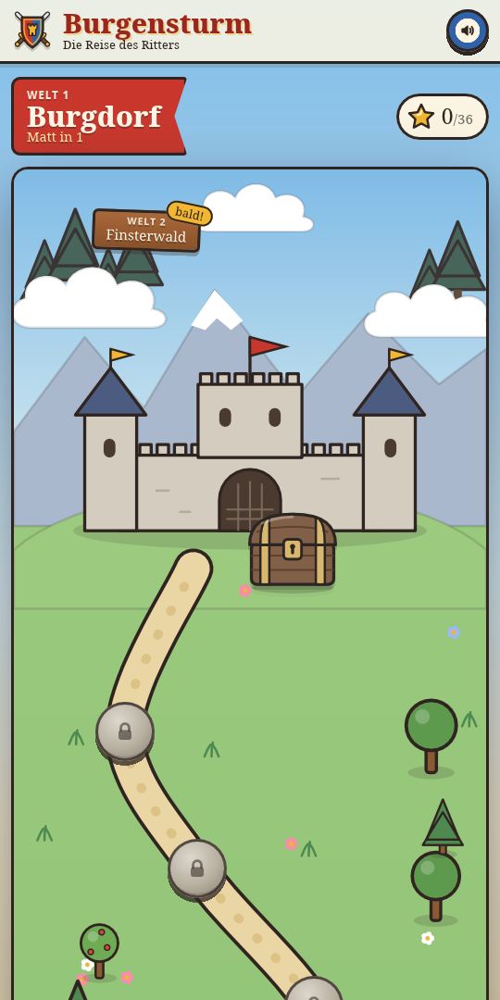
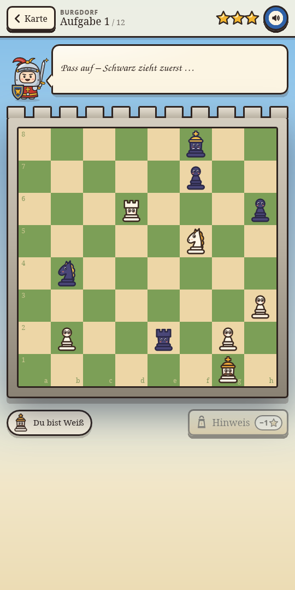

<div align="center">

# Adventure Chess

**Chess puzzles for little knights (ages 5–10)**

<p>
  
  
</p>

On the map, Knight Kuno travels from puzzle to puzzle. Every solved puzzle brings
him one step closer to the castle – and to the treasure chest at the end of the world.

</div>

## What's inside

- **World 1 "Burgdorf":** 12 mate-in-1 puzzles, real positions from the
  [Lichess puzzle database](https://database.lichess.org/) (CC0, Elo ~400–800)
- **Kid-friendly controls:** tap a piece, tap a target square. The opponent moves
  automatically, wrong moves wobble.
- **3-star system:** three stars without help, one star with a hint
- **Knight Kuno accompanies every puzzle** with a short mission in child-friendly language
- **Sound and music** via Web Audio, with a mute button
- **No backend, no accounts:** progress is stored locally in `localStorage`

## Getting started

The app is publicly playable at **[kids-chess.wondrax.cloud](https://kids-chess.wondrax.cloud/)** – just open it in your browser, no installation needed.

For local development:

```bash
npm install
npm run dev
```

| Command | Purpose |
| --- | --- |
| `npm run dev` | Start the development server |
| `npm run build` | Typecheck + production build to `dist/` |
| `npm run puzzles` | Re-fetch puzzles from the Lichess DB (requires `curl` and `zstd`) |

## How it's built

```
src/game/            worlds, progress, map geometry, sounds
src/hooks/usePuzzle.ts   the flow of one puzzle (opponent move, move checks, stars)
src/components/      screens and the cartoon SVGs (pieces, Knight Kuno, map)
src/data/puzzles.json    generated puzzle data – do not edit by hand
scripts/extract-puzzles.mjs   generates puzzles.json from the Lichess DB
```

A new world takes three steps: add the world at the top of `scripts/extract-puzzles.mjs`,
run `npm run puzzles`, register it in `src/game/worlds.ts`.

## Tech

React 19, Vite and [chess.js](https://github.com/jhlywa/chess.js) – nothing more
is needed. Everything runs in the browser; the app is built mobile-first (phone and
tablet, portrait).

## Roadmap

Where the journey goes next – World 2 "Finsterwald", endless mode, offline support as a
PWA, ranks, and a customizable knight avatar – is tracked in the
[issues](https://github.com/markuswondrak/kids-chess-training/issues).

---

The puzzle data comes from the Lichess puzzle database and is licensed under CC0.
